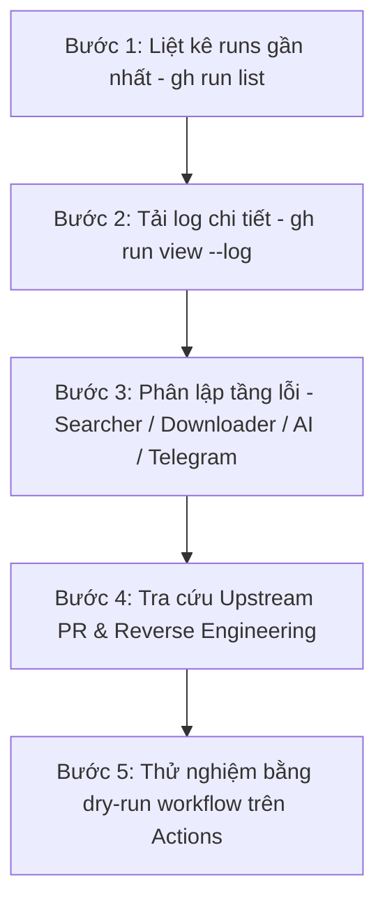

# Sổ Tay Kỹ Thuật Xử Lý Sự Cố Phức Tạp (Debugging Playbook)
## DanceCoverUni Automation Pipeline

Tài liệu này hệ thống hóa toàn bộ phương pháp luận, quy trình điều tra và các giải pháp kỹ thuật chuyên sâu để xử lý các lỗi phức tạp liên quan đến cào dữ liệu (scraping), tải video (video downloading), vượt cơ chế chống bot (anti-bot bypass), và tích hợp API trên nền tảng GitHub Actions CI/CD.

---

## 1. Quy Trình Điều Tra 5 Bước Trên GitHub Actions

Khi phát hiện workflow thất bại hoặc video không được phân phối như kỳ vọng:



### Bước 1: Liệt kê các lần chạy gần đây
```powershell
gh run list --workflow=pipeline.yml -L 5
```

### Bước 2: Xem chi tiết và trích xuất nhật ký lỗi
```powershell
# Xem tổng quan trạng thái
gh run view <run_id>

# Lấy log của job thực thi và lọc từ khóa lỗi
gh run view <run_id> --log --job <job_id> | Select-String "ERROR", "WARNING", "failed"
```

### Bước 3: Phân lập module phát sinh lỗi
- **Tầng Cào (Searcher / Dorking)**: Tìm kiếm log `src.searcher`. Xem Jina có trả về URLs không, có dính mã lỗi `403/429` hay regex bị dính ký tự lạ ở đuôi URL (`.,:;…!?'\"/`).
- **Tầng Tải (Downloader)**: Tìm log `src.downloader`. Xác định xem Layer 1 (yt-dlp CLI thuần), Layer 2 (cookies), hay Layer 3 (Direct API) gặp lỗi gì ("Fresh cookies needed", "Video unavailable", "403 Forbidden").
- **Tầng Trí Tuệ Nhân Tạo (AI Gate)**: Tìm log `src.quality_checker` và `src.ai_keywords`. Kiểm tra xem API key có hoạt động, danh sách model nào khả dụng (`gemini-3.1-flash-lite`, `gemini-3.5-flash-lite`), có bị lỗi Rate Limit (429) không.
- **Tầng Phân Phối (Upload & Notifier)**: Tìm log `src.telegram_notifier` hoặc `src.youtube_uploader`. Kiểm tra kích thước file (>50MB đối với Telegram Bot API), mã phản hồi HTTP, quyền hạn Telegram Chat ID.

### Bước 4: Kiểm tra bản vá Upstream & Phân tích giải mã
Nếu một nền tảng (Douyin, TikTok, YouTube) thay đổi thuật toán:
- Tuyệt đối không chỉ ngồi chờ bản release chính thức của `yt-dlp` (thường trễ từ vài tuần đến vài tháng).
- Truy cập trực tiếp tab **Pull Requests** của repository upstream: `https://github.com/yt-dlp/yt-dlp/pulls`.
- Tìm kiếm từ khóa: `douyin`, `tiktok`, `signature`, `ttwid`, `cookies`.
- Kiểm tra các commit, phân tích PR đang mở, và lấy nhánh vá của tác giả (ví dụ: `viking1304/yt-dlp@douyin-fix`).

### Bước 5: Kiểm chứng độc quyền qua GitHub Actions Dry-Run
- **Tuyệt đối không chạy trên máy local Windows**.
- Kích hoạt pipeline chế độ giả lập:
  ```powershell
  gh workflow run pipeline.yml -f dry_run=true
  gh run watch <run_id> --exit-status
  ```

---

## 2. Giải Quyết Triệt Để Cơ Chế Chống Bot Của Douyin

### Hiện tượng lỗi điển hình
1. **Lỗi 1**: `ERROR: [Douyin] <video_id>: Fresh cookies (not necessarily logged in) are needed`.
2. **Lỗi 2**: `HTTP Error 403: Forbidden` khi tải trực tiếp luồng stream.
3. **Lỗi 3**: API Aweme Detail trả về mã `status_code: 0` hoặc rỗng `aweme_detail: null`.

### Nguyên nhân cốt lõi
Douyin triển khai hệ thống xác thực bảo mật đa tầng phía Client:
1. **Cookie `ttwid`**: Mã định danh thiết bị bắt buộc, cấp phát qua endpoint đăng ký nội bộ.
2. **Header `x-tt-trace-host` & `uifid`**: Khóa truy vết hạ tầng ByteDance.
3. **Chữ ký số `x-secsdk-web-signature`**: Chuỗi hash bảo vệ các truy vấn Aweme Detail, sử dụng muối bí mật (Salt) và thuật toán băm query string.

### Giải pháp kỹ thuật 3 tầng (3-Tier Architecture)

#### Tầng 1: CLI `yt-dlp` vá lỗi (PR #17826)
Cài đặt trực tiếp từ nhánh PR của tác giả giải quyết dứt điểm chữ ký số mà không cần cookie:
```yaml
pip install "curl_cffi>=0.7.0" "git+https://github.com/viking1304/yt-dlp.git@douyin-fix"
```
Kết hợp tùy chọn `--impersonate chrome` thông qua `curl_cffi`.

#### Tầng 2: CLI `yt-dlp` kèm Cookie
Khi IP của GitHub Runner bị đưa vào diện nghi vấn (rate limit tạm thời):
- Ghi chuỗi Netscape cookies từ GitHub Secrets `DOUYIN_COOKIES` vào file tạm thời `temp_douyin_cookies.txt`.
- Chạy `yt-dlp --cookies temp_douyin_cookies.txt`.

#### Tầng 3: Direct API độc lập có Chữ Ký Số trong Python
Triển khai thuật toán ký độc lập trực tiếp trong `src/downloader.py`:
```python
_SEC_SALT = 'A96D855A08C0A9707F8BEF0D9A527E4E'
_AID = 6383

def sign_douyin_query(query_str: str) -> str:
    """Ký số chuỗi query với salt của ByteDance SDK."""
    salted = query_str + _SEC_SALT
    return hashlib.md5(salted.encode('utf-8')).hexdigest()

def get_douyin_ttwid(session) -> Optional[str]:
    """Tự động đăng ký và lấy cookie ttwid hợp lệ từ Douyin."""
    reg_url = "https://www.douyin.com/ttwid/register"
    reg_data = json.dumps({
        "region": "cn", "aid": _AID, "needFid": "0", "service": "www.douyin.com",
        "migrate_info": {"ticket": "", "source": "node"}, "cbUrlProtocol": "https", "union": "true"
    })
    resp = session.post(reg_url, data=reg_data, timeout=10)
    return session.cookies.get("ttwid")
```

---

## 3. Xử Lý Bẫy Dữ Liệu Dorking & Cào URLs

### Bẫy 1: Ký tự rác ở đuôi URL cào được
- **Hiện tượng**: Jina Search hoặc Google Dorking trả về văn bản chứa link như:
  `https://www.douyin.com/video/7674997303296008774...` hoặc `...7674997303296008774,`
- **Hậu quả**: ID bị sai lệch khiến yt-dlp báo 404 Not Found hoặc không nhận diện được extractor.
- **Giải pháp**: Xây dựng hàm `canonicalize_url()` với regex định dạng chuẩn và phương thức `.rstrip(".,:;…!?'\"/) \t\n")`.

### Bẫy 2: Link rút gọn (`v.douyin.com`)
- **Hiện tượng**: Link chia sẻ trên app di động thường có dạng rút gọn `https://v.douyin.com/xxxx/`.
- **Giải pháp**: Tự động gửi request `HEAD` với `User-Agent` di động (iPhone Safari) và `allow_redirects=True` để lấy URL đích chuẩn `/video/<id>`.

---

## 4. Quản Lý & Bảo Vệ Quota API

### Jina AI Search Quota
- Jina cung cấp dung lượng token qua header `x-usage-tokens` hoặc `x-ratelimit-remaining-tokens`.
- Khi dung lượng còn lại xuống dưới ngưỡng an toàn (**<= 1,000,000 tokens**):
  - Tự động kích hoạt cờ cảnh báo trên Telegram Executive Summary.
  - Người dùng có đủ thời gian tạo tài khoản/API key Jina mới và bổ sung vào GitHub Secrets.

### Gemini API Model Availability
- Thay vì gán cố định một model tĩnh (dễ bị 404 hoặc deprecated khi Google nâng cấp):
  - Gọi `client.models.list()` để xác thực danh sách active models thực tế.
  - Sắp xếp độ ưu tiên: `gemini-3.1-flash-lite` -> `gemini-3.5-flash-lite` -> `gemini-2.5-flash`.
